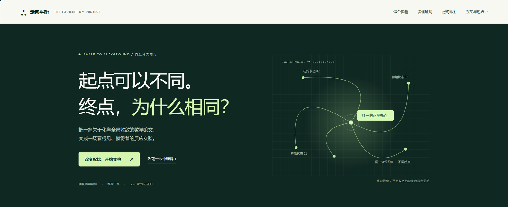

# 走向平衡 · 交互论文解读

把一篇关于细致平衡质量作用系统全局收敛的数学论文，做成可以离线打开的交互页面。改变初始配比，观察不同的起点怎样走向同一个平衡。



## 这是什么

页面围绕论文 *Global Convergence of Detailed Balanced Mass Action Systems* 展开，用可操作的模拟、相图、公式卡片和证明步骤，解释一个结论：在满足细致平衡的有限反应网络里，每个正相容类都有唯一正平衡，所有正轨迹都会收敛到它。

## 功能

- 论文 §5.1 三物种网络的五组预设初值，也可以拖动滑块或点击相图自定义配比
- 相图、浓度随时间变化、自由能对数曲线，支持播放、暂停和拖动时间轴
- 四步证明的可切换说明，配有概念示意图
- 论文全部编号公式 (2.1)–(3.8) 与关键证明公式，共 19 张可搜索卡片
- 真实化学补充示例：2NO₂ ⇌ N₂O₄
- 原文 Figure 1 与独立重算曲线的对照

## 运行

这是一个静态页面，没有构建步骤。不需要安装，也不需要联网。下载或克隆仓库后，双击 `index.html`，用现代浏览器打开即可。

```bash
git clone https://github.com/AERAL-Qantol/chemical-equilibrium.git
cd chemical-equilibrium
```

请保留 `assets/`、`style.css`、`app.js` 与 `index.html` 的相对位置。

如果浏览器限制本地文件，可以在仓库根目录启动一个静态服务器：

```bash
python -m http.server 8000
```

然后访问 `http://localhost:8000/`。

## 使用

- 在“02 / 你的反应实验台”选择预设，或拖动 A、B、C 的初始份额
- 点击“播放演化”观察轨迹，拖动时间轴可以停在任意时刻
- 在“浓度随时间”和“自由能下降”之间切换
- 在“06 / 公式地图”搜索符号或概念，例如“守恒”“对数”“唯一”

## 目录

| 路径 | 内容 |
| --- | --- |
| `index.html` | 页面结构 |
| `style.css` | 页面样式 |
| `app.js` | 数值模拟、SVG 绘图与交互 |
| `assets/paper.pdf` | 论文原文，23 页 |
| `assets/paper-figure-1.png` | 从论文 PDF 提取的 Figure 1 |
| `assets/katex/` | KaTeX 0.16.11 与字体，MIT 许可证 |
| `docs/screenshots/` | README 使用的截图 |

## 论文来源

- 标题：*Global Convergence of Detailed Balanced Mass Action Systems*
- 作者：Haoran Lv, Chengjin Ni, Manqin Wang, Shenli He（BitMiracle AI Lab）
- arXiv：[2610.30808](https://arxiv.org/abs/2610.30808)，2026 年 10 月 22 日
- 本地副本：[assets/paper.pdf](assets/paper.pdf)
- 作者公开的 Lean 工程：[BitMiracle-AI/detailed-balance-gac](https://github.com/BitMiracle-AI/detailed-balance-gac)

## 数值说明

三物种曲线用四阶 Runge–Kutta 独立重算，内部步长 0.002，显示区间 0 ≤ t ≤ 8，每 0.01 保存一次。论文原图使用 LSODA，因此这里的曲线不是原图数据。数值模拟用于理解，不代替定理证明。

2NO₂ ⇌ N₂O₄ 示例使用无量纲教学参数，不是实验数据。自由能图只显示 V ≥ 10⁻¹² 的部分。

## 许可

本仓库尚未添加开源许可证，代码与文字的复用请先联系作者。

论文 PDF 与 Figure 1 来自 arXiv:2610.30808，按 [CC BY 4.0](https://creativecommons.org/licenses/by/4.0/) 使用。KaTeX 采用 MIT 许可证，见 [assets/katex/LICENSE](assets/katex/LICENSE)。
